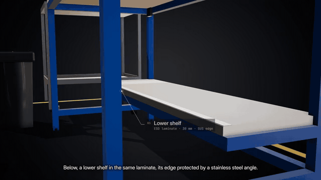

# How I made this video, and how you can make one too



A 3D explainer in 1080p, with an English narrator, subtitles, music and sound effects:
- **v2:** 111 s, built from the updated PowerPoint spec.
- **v1:** 80 s, built from the first spec.

It was made **only with AI tools**: no camera, no 3D software, no video editor and no stock footage. I described what I wanted to an AI coding agent (**Claude Code**). The agent built the 3D model in code from the spec, wrote the script, generated the voice, composed the music and rendered the film on my laptop.

▶ **Watch:** https://chokylion.github.io/imi-workstation-video/
⬇ **Download:** [v2](https://github.com/Chokylion/imi-workstation-video/releases/download/v2/imi-workstation-v2.mp4) · [v1](https://github.com/Chokylion/imi-workstation-video/releases/download/v1/imi-workstation.mp4)
🧩 **Source:** [`source/imi-workstation-v2/`](source/imi-workstation-v2/) · [`source/imi-workstation/`](source/imi-workstation/)

---

## 1. The tools and skills used

**To make your own:** install the `3d-explainer` skill with one command (see [section 4](#4-what-you-need-and-how-to-set-it-up)). It sets up lemo-opuscar and OpenMontage by itself the first time. Licences and tested versions are in [`THIRD-PARTY.md`](THIRD-PARTY.md).

| # | Tool / skill | What it did in this video | Where to get it |
|---|---|---|---|
| 1 | **Claude Code** (model: Claude Opus 5.5) | The AI agent that ran everything: read the guides, asked me questions, wrote all the code, checked the results | https://claude.com/claude-code |
| 2 | **lemo-opuscar** (Lemo Lab), the main video skill | A library of 66 film styles made entirely in code. I used the **Exploded Teardown** style: photoreal 3D, the camera travels to each part, labels and dimension lines drawn on the object. It also provides the render tools (headless Chrome, frame by frame), the voice tools, the sampler and the mixer | the 3d-explainer skill downloads the tested version · https://github.com/lemomo-ai/lemo-opuscar |
| 3 | **OpenMontage**, the directing skills | Two of its skills: `skills/meta/voice-performance-director.md` (pace, pauses and emphasis for each narration line, with a test line first) and `skills/meta/reviewer.md` (a quality review after each stage). Only these two files are read; nothing to install | the 3d-explainer skill downloads the tested version · https://github.com/calesthio/OpenMontage |
| 4 | **3d-explainer** (my skill, written after the two videos) | Everything learned while making v1 and v2, as one skill: start from this film's source, trace every number, check the label timing **before** the 40-minute render, the Windows fixes, and the full list of final checks. Works in GitHub Copilot and Claude Code | [`skills/3d-explainer/`](skills/3d-explainer/) (one-command install, section 4) |
| 5 | **skill-router** (my skill) | Picks and chains the right skills for a task, shows the plan, and finishes with the CEO review | [`skills/skill-router/`](skills/skill-router/) (Claude Code; optional) |
| 6 | **My own working-style rules** (`~/.claude/CLAUDE.md`) | Plan before building, ask **one question at a time**, verify before saying "done", then a final "CEO review" against the original request and a short report | quoted in section 5; the 3d-explainer skill carries the parts it needs |
| 7 | **superpowers** (Claude Code plugin) | `using-superpowers` loads at the start of every session and makes the agent check for a matching skill before acting | https://github.com/obra/superpowers (Claude Code; optional) |
| 8 | **Claude Code plan mode** | The agent first wrote a plan and I approved it before anything was installed | built into Claude Code |
| 9 | **pptx skill** (Anthropic skills, used for v2) | Read my PowerPoint: every slide's text, plus the CAD view, the hand sketches and the product photos inside it, so the v2 model matches the updated spec | built into Claude Code (`anthropic-skills:pptx`). It is Anthropic's, so it is not copied here; see [`THIRD-PARTY.md`](THIRD-PARTY.md) |

**Engines underneath** (installed by lemo-opuscar, all free):
- **three.js**: the 3D model and rendering.
- **Kokoro TTS**: the narrator voice `af_heart`, which runs offline.
- **faster-whisper**: listens back to every voice line to check it was spoken correctly.
- **VCSL samples** (CC0): marimba, vibraphone and glockenspiel.
- **ffmpeg**: muxing and loudness mastering.
- **Playwright headless Chrome**: frame capture.

**Tried and dropped:**
- `higgsfield-ai/higgsfield` is a GPU training framework, not a video generator.
- `debpalash/VoiceStudio` wasn't needed, because lemo-opuscar has its own offline voice.

**Other skills I have that suit this kind of work** (not used here): `superpowers:brainstorming`, `superpowers:verification-before-completion`, `remotion-motion-graphics` (React/Remotion motion graphics), `chonimate` (2D story reels).

---

## 2. My actual prompts (word for word, in order)

**Prompt 1** (first idea; this pair of repos turned out to be the wrong tools)
> https://github.com/debpalash/VoiceStudio
> https://github.com/higgsfield-ai/higgsfield
> clone this 2 repo i will let u make ai vdo to review some items. make sure these two skills use together to create the best vdo that have sound

**Prompt 2** (the real one, with a reference slide image and the spec)
> https://github.com/calesthio/OpenMontage
> https://github.com/lemomo-ai/lemo-opuscar
> try this two repo [reference slide image] this is what i want, i will give u all info
>
> *Workbench / Inspection Material Table Specification*
> Overall Dimensions • Size: L1550 × W750 × H2200 mm
> Structure • Frame: 40 × 40 mm square steel tubing, powder-coated blue • Worktop: 25 mm thick white Formica laminate
> Upper Cabinet • Single full-length cabinet with one full-width swing door (no center split), equipped with recessed pull handle and key lock. • Color: White • Size: L1550 × W300 × H400 mm
> Electrical System • Power Strip: 4-outlet power rail, 1550 mm long, mounted at the rear of the workbench
> Lighting System • Installed at the top of the frame • Lighting panel extends 700 mm forward from the frame • Support brackets positioned at approximately 45° • Full-length LED linear light, dimensions L1550 × W300 mm • Equipped with ON/OFF switch • No under-cabinet lighting • No frame posts extending above the lighting assembly
>
> Complete the layout by adding and positioning one material cart, one ESD magnifying lamp, and two operator chairs around the workstation as shown in the reference images.
> • One stainless steel material cart, size L750 × W600 × H600 mm, positioned on the left side of the workstation.
> • One ESD LED magnifying lamp mounted at the left rear corner of the worktop, with the arm extended toward the center inspection area.
> • Two blue ESD operator chairs with foot rings and casters positioned in front of the workstation.
>
> let make some vdo like to teach or educate people that u explain about that table that esd table what function dimension what they can do in english. i want it to be like 3d model then zoom in to each part then explain what is it

**Prompt 3** (the purpose, from my senior, originally in Thai)
> The video just needs to say that we will define a location for Indirect Material Inspection. It has a table with a closable cabinet, a cart for fetching material, and a magnifying lamp for visual checks, with 1–2 operators. The main goal is to simulate building the workspace **with AI tools only**. I just don't know how to have a person speaking in the video.

**My answers to the agent's questions:**
1. Style: **Exploded Teardown**.
2. The person speaking: **an AI narrator voice**.

**Prompt 4** (v2, 13 Nov 2026: the updated spec as a PowerPoint file)
> "C:\Users\...\Downloads\Indirect Material location.pptx" now try to do this ไปแกะข้อมูลมาละกัน *(Thai: "go and dig the information out of it")*

The agent read all 4 slides: the spec text, a CAD view, two hand sketches, product photos and the list of tools in the cabinet. It listed what had changed and flagged where the slides disagree, for example 30 mm vs 25 mm worktop and 4 vs 8 outlets. Then it asked me one question: update the existing video, make a new one, or only summarise the data. I chose **"Video v2 (update existing)"**.

v2 adds:
- the 30 mm ESD laminate worktop
- the lower shelf with its stainless edge
- the measuring tools inside the cabinet
- the 2-level cart (750 × 500 × 900)
- the black ESD waste bin
- the notebook computer
- the 8× magnifier
- the worktop height (880–900 mm, from the sketch)
- the equipment shared from other areas, on the end card

Every number is traced to its slide in [`FACTS-v2.md`](FACTS-v2.md).

That's everything I typed. The agent did the rest.

---

## 3. A prompt you can copy for your own item

**Short version** (with the 3d-explainer skill installed, it knows the rest):

```text
Use the 3d-explainer skill to make an English 3D explainer video of [your item] from [path to your .pptx / .pdf spec].
It's for [who watches it and why]. About [60–120] seconds.
```

**Long version** (works without the skill): paste this into Claude Code after setup (section 4), then fill in the brackets:

```text
Using the lemo-opuscar library (~/lemo-opuscar) in the "Exploded Teardown" style, and OpenMontage's
voice-performance-director and reviewer skills (~/OpenMontage/skills/meta/), make an educational 3D explainer video.

Subject: [what it is, e.g. "an ESD inspection workbench with cart, magnifier and two chairs"]
Purpose: [who watches it and why, e.g. "show managers the proposed workstation layout"]
Spec (use ONLY these numbers, never invent any):
[paste your full spec sheet / dimensions / materials / colours / positions]

What I want:
- start from the 3D model, then the camera zooms into each part and the narrator explains what it is, its size and what it does
- English narration with an AI voice (Kokoro), subtitles burned in plus an .srt file
- original music and a sound for every action; about 60–90 seconds; 1920x1080
- labels and dimension lines drawn on the model; say on screen that the model is built from the spec
Ask me one question at a time if something is unclear. Show me test frames before the full render,
check every voice line with speech-to-text, and run the reading-time check before you say it's done.
```

Tips:
- Reference images help the agent place parts the way you want.
- You don't have to type the spec: give the file path of a PowerPoint (or PDF) and say "read the data from this". The agent reads the text, the drawings and the photos, and tells you where they contradict each other.
- Any style in the lemo-opuscar gallery can replace "Exploded Teardown": https://lemomo-ai.github.io/lemo-opuscar/
- For your own voice, say "I'll record the narration": the agent writes the script and times everything to your recording.

---

## 4. What you need and how to set it up

**Computer:**
- Windows 10/11, macOS or Linux, with at least 5 GB of free disk space. The install takes about 2.2 GB, and each film needs a few hundred MB more.
- A GPU helps, but plain **Intel UHD graphics worked**: about 0.6 s per frame, so about 25 min to render 80 s.

**Install these first:**
- Claude Code (with access to a Claude Opus model; lemo-opuscar is tuned for Opus 5.5)
- Git, Node.js 20+, ffmpeg 7+, and Python 3.11–3.13 (or [uv](https://docs.astral.sh/uv/), which fetches Python itself)

On Windows: `winget install Git.Git OpenJS.NodeJS.LTS Gyan.FFmpeg astral-sh.uv`, then reopen Git Bash.

**Then install the skill** (one command, in any terminal):
```sh
npx -y skills add Chokylion/imi-workstation-video -g -a github-copilot -s 3d-explainer -y --copy
```
- This works for GitHub Copilot: the app, the CLI and VS Code. For Claude Code, use `-a claude-code`.
- The skill goes into `~/.copilot/skills/3d-explainer`.
- The first time you ask for a video, the skill runs its own [`scripts/setup.sh`](skills/3d-explainer/scripts/setup.sh). It downloads lemo-opuscar and OpenMontage at the tested versions, plus their packages, voice model, studio lighting and instruments (about 2 GB, 10–20 minutes, once). It applies all the Windows fixes below. To run it yourself first: `sh ~/.copilot/skills/3d-explainer/scripts/setup.sh`.

<details><summary><b>Manual setup</b> (what the skill's setup.sh does, step by step)</summary>

```sh
cd ~
git clone --depth 1 https://github.com/lemomo-ai/lemo-opuscar.git
git clone --depth 1 https://github.com/calesthio/OpenMontage.git
cd ~/lemo-opuscar
export LEMO_OPUSCAR_HOME=$HOME/lemo-opuscar   # Windows: avoids a C:/ path bug in lemo-opuscar's setup.sh
sh plugin/skills/lemo-opuscar/scripts/setup.sh deps            # npm packages + headless Chrome + Python venv
export PYTHONUTF8=1
sh tools/fetch.sh voice                 # Kokoro voice model (~350 MB)
sh tools/fetch.sh hdri                  # studio lighting (12 MB)
sh tools/fetch.sh instruments vcsl      # mallet instruments (~285 MB)
```

**Windows-only fixes** (the guide says WSL, but this worked natively):
- The venv uses `Scripts\` instead of `bin/`. In PowerShell, run:
  `New-Item -ItemType Junction -Path "$HOME\lemo-opuscar\.venv\bin" -Target "$HOME\lemo-opuscar\.venv\Scripts"`
- Then install the Python packages directly:
  `uv pip install --python .venv/Scripts/python.exe -r requirements.txt -r requirements-voice.txt`
- Set `PYTHONUTF8=1` before `tools/fetch.sh` and the voice tools, or they crash printing arrows.
- Don't run bare `python3` on Windows: the Microsoft Store stub can hang. Use `.venv/Scripts/python.exe`.

More Windows problems and their fixes: [`skills/3d-explainer/references/windows-setup.md`](skills/3d-explainer/references/windows-setup.md).

</details>

Alternatively, lemo-opuscar can be installed as a Claude Code plugin and started with a slash command:
```sh
claude plugin marketplace add lemomo-ai/lemo-opuscar
claude plugin install lemo-opuscar@lemolab      # then in Claude Code: /lemo-opuscar:lemo-opuscar
```

**Rebuild this exact video from the source in this repo:**
```sh
cp -r source/imi-workstation-v2 ~/lemo-opuscar/films/   # or source/imi-workstation for v1 (fonts included, SIL OFL)
sh ~/lemo-opuscar/films/imi-workstation-v2/build.sh        # voice check → render → mix → master → .srt → checks (WORKERS=2, about 35–40 min)
```

---

## 5. What the agent actually did (the pipeline)

1. **Read the repos:** it found that higgsfield isn't a video tool, picked lemo-opuscar plus OpenMontage, and wrote a plan that I approved.
2. **Asked me 2 questions, one at a time:** the film style and how to do the "person speaking".
3. **Wrote the treatment** (`TREATMENT.md`): three possible story structures and the chosen one (empty location → parts assemble → follow the material flow → people → pull back), a shot list, a beat sheet, a cue map and a sound-design table. It also wrote OpenMontage's voice-performance plan.
4. **Voice:** it tested the hardest line first (the sample gate), then generated 11 lines with Kokoro. Whisper listened back to every line to check the words and numbers.
5. **3D model** in three.js at true millimetre scale, straight from the spec: blue 40×40 frame, 25 mm laminate top, top-hinged cabinet with key lock, 4-outlet rail, LED panel on 45° brackets, stainless cart, ESD magnifier, two ESD chairs, and translucent operator figures.
6. **Review loops on still frames:** it rendered contact sheets, found problems and fixed them. Examples: tan-looking white surfaces, the light looking on before the switch, the lamp hitting the cabinet, labels off screen.
7. **Sound:** an original score at 90 BPM in G (marimba, vibraphone, glockenspiel, synth bass). Every action has its own sound: the frame clank, cart casters, the switch click, the door hinge, the key turn. There are two deliberate silences: before the light switches on and before the final pull back.
8. **Render and master:** 1,920 frames in headless Chrome, mixed with the voice about 9 dB over the music, mastered to −14 LUFS.
9. **Final checks:**
   - Whisper on the finished film heard all 11 lines and every number correctly.
   - No black frames.
   - Every label stays on screen long enough to read.
   - Every number is traced to the spec in [`FACTS.md`](FACTS.md).
10. **CEO review:** it scored the result against my original request ("3D model, zoom into each part, explain, English, with sound") and reported honest gaps.

Time: about 2–3 hours of agent work in one session, plus about 25 minutes of rendering.

### My working-style rules (from `~/.claude/CLAUDE.md`)
```text
For any non-trivial task:
1. Route first: pick the right skill or skill-chain and show the pipeline.
2. Design before building: agree on the approach before writing code.
3. One question at a time: one focused, multiple-choice question per message.
4. Verify before claiming done: run the checks and report failures honestly.
5. CEO review loop: re-read the original prompt, score the result, add one concrete improvement idea (max 3 loops).
6. Brief report: what was built, the loops, how it matches the ask, honest gaps.
```

---

## 6. Honest limits

**v2** (the current video):
- **Conflicts between the slides.** These still need a human to confirm them, and each is logged in [`FACTS-v2.md`](FACTS-v2.md):
  - worktop thickness: 30 mm or 25 mm (the video uses 30 mm)
  - outlets: 4 or 8 (the video uses 4)
  - lower shelf: 350 × 240 or 350 × 2440 (the video states only its 30 mm thickness)
- The measuring tools in the cabinet are simple models, not the real Mitutoyo products.
- Around 87–90 s there is about 4 s with music only and no narration.
- The true peak is −1.0 dB, right at the limit.
- The power outlets are a generic style, not a specific country's plug type.

**v1:**
- There was no CAD file, so some sizes are illustrations and are never stated as numbers: worktop height, cabinet mounting height, lamp arm lengths, and the contents of the cabinet and cart. See [`FACTS.md`](FACTS.md).
- Around 16–20 s, a small glint on the light frame makes the panel look slightly lit before the switch moment. This is fixed in v2.

Credits and licences for everything in the film: [`CREDITS`](CREDITS).

