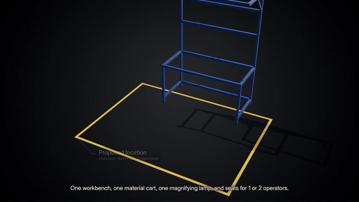

# Indirect Material Inspection Workstation: 3D explainer video

**▶ Watch:** https://chokylion.github.io/imi-workstation-video/
**⬇ Download:** [imi-workstation.mp4](https://github.com/Chokylion/imi-workstation-video/releases/latest/download/imi-workstation.mp4) (80 s, 1920×1080, English narration and subtitles)
**🛠 How I made it, and how you can too:** [HOW-I-MADE-THIS.md](HOW-I-MADE-THIS.md): every skill and tool used, my exact prompts, a copy-paste prompt, requirements and setup.

The proposed location for indirect material inspection:
- a workbench (1550 × 750 × 2200 mm) with a blue powder-coated steel frame and a white laminate top
- a lockable upper cabinet, an LED linear light and a 4-outlet power rail
- a stainless steel material cart on the left
- an ESD LED magnifying lamp at the left rear corner
- two blue ESD operator chairs for 1–2 operators

Made entirely with AI tools: Claude Code + [lemo-opuscar](https://github.com/lemomo-ai/lemo-opuscar) (Exploded Teardown style) + [OpenMontage](https://github.com/calesthio/OpenMontage) directing skills. The 3D model is built from the specification sheet and is an illustration, not a manufacturing drawing. Every number shown is listed against the spec in [FACTS.md](FACTS.md); assets and licences are in [CREDITS](CREDITS); the full film source is in [`source/`](source/imi-workstation/).
