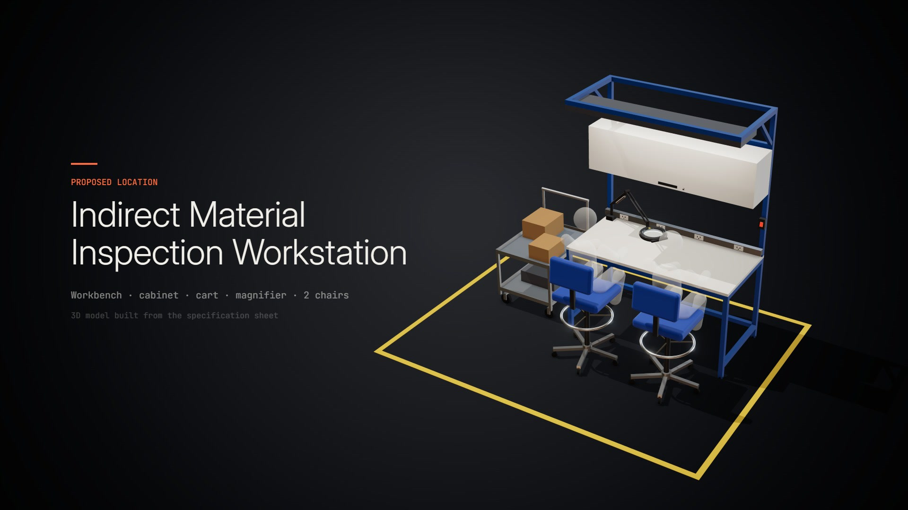

# Indirect Material Inspection Workstation: 3D explainer video

**▶ Watch:** https://chokylion.github.io/imi-workstation-video/
**⬇ Download:** [imi-workstation.mp4](https://github.com/Chokylion/imi-workstation-video/releases/latest/download/imi-workstation.mp4) (80 s, 1920×1080, English narration and subtitles)

The proposed location for indirect material inspection:
- a workbench (1550 × 750 × 2200 mm) with a blue powder-coated steel frame and a white laminate top
- a lockable upper cabinet, an LED linear light and a 4-outlet power rail
- a stainless steel material cart on the left
- an ESD LED magnifying lamp at the left rear corner
- two blue ESD operator chairs for 1–2 operators

The 3D model is built from the specification sheet and made entirely with AI tools: three.js rendered in code, an offline AI narrator, and an original score. It is an illustration, not a manufacturing drawing. Every number shown is listed against the spec in [FACTS.md](FACTS.md); third-party assets and licences are in [CREDITS](CREDITS).
